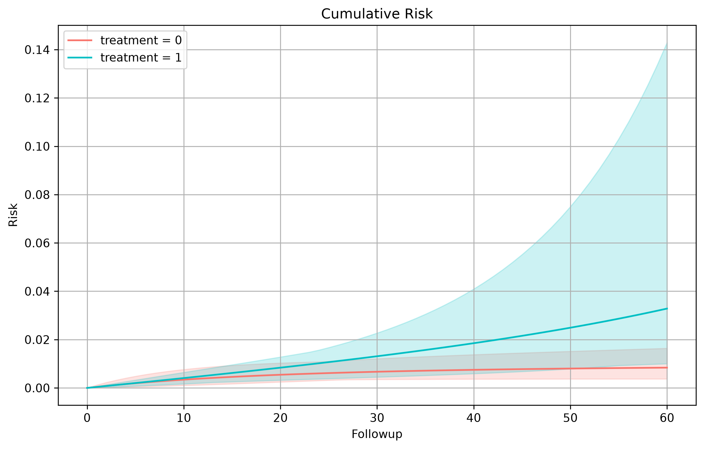

# Exploring Results

Recall our previous example, {doc}`More Advanced Analysis <more_advanced_models>`, where we finalized and collected our results with 

```python
my_output = my_analysis.collect()
my_output.to_md()
```
Let us now go over what the dump to md looks like and explore our output in further detail.

## SEQuential Analysis: {date}: censoring

## Weighting

We begin by exploring the weight models, this gives us general information about the denominator model, as well as weight statistics before applying any limits. With pre-expansion weights and excused conditions the numerator is fixed at 1, so there is no numerator model and the weights are not stabilized; they have a long right tail, which is why we bound them at the 1st and 99th percentiles. This means that in the outcome model our weights will be bound at [0.999954, 19.8889].

We should also note here that with pre-expansion weights the denominator model has the treatment as its dependent variable. With post-expansion weights (`weight_preexpansion=False`), excused-censoring models hold `switch` as the dependent variable instead.

### Denominator Model

```
                           Logit Regression Results                           
==============================================================================
Dep. Variable:                tx_init   No. Observations:                 6137
Model:                          Logit   Df Residuals:                     6130
Method:                           MLE   Df Model:                            6
Date:                Tue, 13 Oct 2026   Pseudo R-squ.:               0.0006500
Time:                        10:31:40   Log-Likelihood:                -3017.9
converged:                       True   LL-Null:                       -3019.8
Covariance Type:            nonrobust   LLR p-value:                    0.6867
==============================================================================
                 coef    std err          z      P>|z|      [0.025      0.975]
------------------------------------------------------------------------------
Intercept     -2.2157      1.214     -1.824      0.068      -4.596       0.165
sex            0.0331      0.065      0.511      0.609      -0.094       0.160
N             -0.0105      0.006     -1.648      0.099      -0.023       0.002
L             -0.0177      0.052     -0.343      0.732      -0.119       0.083
P              0.0945      0.128      0.741      0.459      -0.156       0.345
time           0.0147      0.024      0.609      0.542      -0.033       0.062
time_sq    -1.602e-05      0.000     -0.066      0.947      -0.000       0.000
==============================================================================
```

### Weighting Statistics

|   weight_min |   weight_max |   weight_mean |   weight_std |   weight_p01 |   weight_p25 |   weight_p50 |   weight_p75 |   weight_p99 |
|-------------:|-------------:|--------------:|-------------:|-------------:|-------------:|-------------:|-------------:|-------------:|
|     0.999923 |      24934.2 |       2.05553 |      33.0393 |     0.999954 |     0.999995 |      1.00002 |      1.26351 |      19.8889 |

## Outcome

After weight information, we begin to gather information about the outcome model itself. This comes from the `fit` whereas survival information (or risk/incidence depending on your specifications) comes from `survival`.

### Outcome Model

```
                 Generalized Linear Model Regression Results                  
==============================================================================
Dep. Variable:                outcome   No. Observations:               670413
Model:                            GLM   Df Residuals:                   670406
Model Family:                Binomial   Df Model:                            6
Link Function:                  Logit   Scale:                          1.0000
Method:                          IRLS   Log-Likelihood:                -3096.8
Date:                Tue, 13 Oct 2026   Deviance:                       6193.6
Time:                        10:31:40   Pearson chi2:                 1.02e+06
No. Iterations:                    13   Pseudo R-squ. (CS):          0.0002477
Covariance Type:            nonrobust                                         
=============================================================================================
                                coef    std err          z      P>|z|      [0.025      0.975]
---------------------------------------------------------------------------------------------
Intercept                    -9.5140      0.371    -25.647      0.000     -10.241      -8.787
tx_init_bas[T.1]             -0.0750      0.343     -0.219      0.827      -0.748       0.598
followup                     -0.0560      0.024     -2.346      0.019      -0.103      -0.009
tx_init_bas[T.1]:followup     0.0581      0.022      2.633      0.008       0.015       0.101
followup_sq                   0.0002      0.000      0.677      0.498      -0.000       0.001
trial                         0.1249      0.018      7.092      0.000       0.090       0.159
trial_sq                     -0.0017      0.000     -4.600      0.000      -0.002      -0.001
=============================================================================================
```

### Survival

If we enable `km_curves` in our options, we can extract risk information between treatment values. These will be returned in the table below. Additionally, plots you create will be stored here.

To note, you can see here we have a risk plot. If you would like a different plot, you can simply specify another plot to be made when calling the class method {py:meth}`~pySEQTarget.SEQuential.plot`. This can be done on any `SEQuential` class object, or when collecting, you can also access the data used to create these plots with

```python
survival_data = my_output.retrieve_data("km_data")
```

#### Risk Differences

|   Followup |   A_x |   A_y |   Risk Difference |   RD 95% LCI |   RD 95% UCI |     RD SE |
|-----------:|------:|------:|------------------:|-------------:|-------------:|----------:|
|         60 |     0 |     1 |        -0.0244359 |  -0.126522   |  -0.00410246 | 0.0270593 |
|         60 |     1 |     0 |         0.0244359 |   0.00410246 |   0.126522   | 0.0270593 |

#### Risk Ratios

|   Followup |   A_x |   A_y |   Risk Ratio |   RR 95% LCI |   RR 95% UCI |   log(RR) SE |
|-----------:|------:|------:|-------------:|-------------:|-------------:|-------------:|
|         60 |     0 |     1 |     0.255543 |     0.114726 |     0.632205 |      0.48761 |
|         60 |     1 |     0 |     3.91324  |     1.58177  |     8.71642  |      0.48761 |

#### Cumulative Risk



## Diagnostic Tables

After all of our primary results, we are met with a few diagnostic tables. These contain useful information to the expanded dataset. Tables with the title 'unique' indicates that one ID can attribute once to the count, e.g. ID A101 in the expanded framework has an outcome in Trial 1, and 2 while on treatment regime = 1. In the unique case, they would only attribute to one count, in the non-unique case, both trials would be included.

Because we have an excused-censoring analysis, we are also provided with information about switches from treatment as well as how many of these switches were excused.

### Unique Outcomes (distinct subjects who had the outcome)

|   tx_init |   outcome |   len |
|----------:|----------:|------:|
|         1 |         0 |   713 |
|         0 |         1 |     5 |
|         1 |         1 |     8 |
|         0 |         0 |   252 |

### Nonunique Outcomes (total outcome events)

|   tx_init |   outcome |    len |
|----------:|----------:|-------:|
|         1 |         0 | 553803 |
|         0 |         0 | 121031 |
|         0 |         1 |     70 |
|         1 |         1 |    209 |

### Unique Followup (distinct subjects contributing follow-up)

|   tx_init_bas |   len |
|--------------:|------:|
|             0 |   828 |
|             1 |   913 |

### Nonunique Followup (person-time intervals)

|   tx_init_bas |    len |
|--------------:|-------:|
|             0 |  59827 |
|             1 | 610586 |

### Unique Switches (distinct subjects who switched)

|   tx_init | isExcused   |   switch |   len |
|----------:|:------------|---------:|------:|
|         1 | False       |        0 |   646 |
|         0 | True        |        1 |    29 |
|         1 | True        |        1 |    33 |
|         0 | False       |        1 |    94 |
|         0 | False       |        0 |   134 |
|         1 | False       |        1 |    42 |

### Nonunique Switches (total switch intervals)

|   tx_init | isExcused   |   switch |    len |
|----------:|:------------|---------:|-------:|
|         0 | True        |        0 |  23012 |
|         0 | False       |        1 |   3394 |
|         1 | False       |        1 |   1306 |
|         1 | False       |        0 | 533916 |
|         0 | False       |        0 |  94695 |
|         1 | True        |        0 |  18790 |
